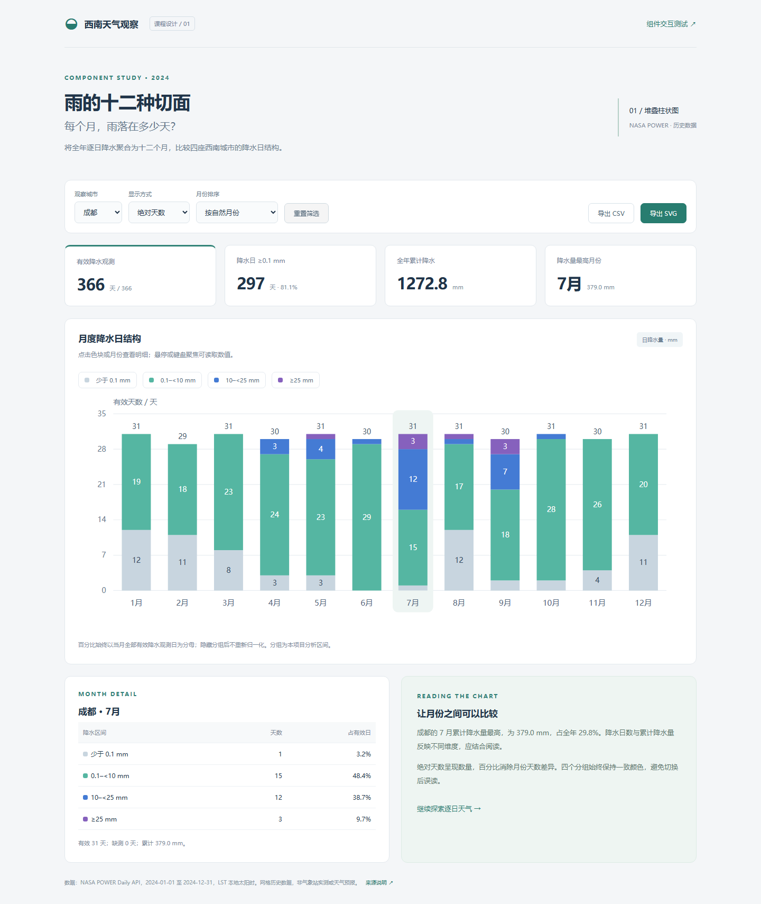

# 任务一_需求文档

公共数据源、字段和计算口径见《期中课程设计报告.md》第 2 章。


## 3  任务一：堆叠柱状图需求文档


### 3.1 背景与目标用户

只看月累计降水，无法区分“多次少量”与“少次较强”的组成。面向课程展示者和一般数据阅读者，设计月度降水日结构组件，同时支持看数量、看比例和查看明细。


### 3.2 可视化介绍

横轴为月份，纵轴为天数或百分比；每个月由四类日降水区间自下而上堆叠。区间分别为 [0,0.1)、[0.1,10)、[10,25)、[25,+∞) mm。它们是本项目的分析分组，未作为官方预警等级。固定颜色为浅灰、浅绿、蓝、紫。

| 编号 | 功能需求 | 可观察的验收标准 |
| --- | --- | --- |
| F1 | 选择四座城市 | 切换城市后统计卡片、柱体、明细和结论同步变化 |
| F2 | 天数 / 百分比切换 | 天数用整数；百分比用有效日为分母，全年不受月份长度差异影响 |
| F3 | 图例控制显隐 | 逐项开关分组；全部关闭出现提示；隐藏后百分比分母保持不变 |
| F4 | 排序与月份选择 | 按自然月份或降水日数降序；点击或 Enter / 空格后更新月份明细 |
| F5 | 明细与解释 | 显示四组天数、占比、有效日、缺测日与累计降水 |
| F6 | 导出与重置 | 导出当前城市全年完整月度 CSV 和当前视图 SVG；重置回成都 7 月 |
| F7 | 异常与空态 | 无有效数据时明确提示，不输出 NaN，不把 null 分到无雨组 |


### 3.3 亮点与非功能需求

组件与页面分离，可传入其他符合格式的逐日数据；数量和组成双视角；明确隐藏图例后的比例含义；保留缺测；原生 SVG 可编辑导出；键盘可触发选择；适配手机，图表在容器内横向滚动。无需联网、安装依赖或启动服务器即可演示。


## 4  任务一：组件结构与接口

| 文件 | 职责 |
| --- | --- |
| data.js | 完整离线数据，挂载为 window.WEATHER_DATA |
| component.js | 分类、月度聚合、可复用 StackedBarChart 组件 |
| app.js | 页面状态、城市和图例筛选、统计解释、导出与重置 |
| index.html / style.css | 可运行交互页面及样式 |
| tests.html / tests.js | 独立组件测试页，自动断言并保留可交互实例 |


### 4.1 接口约定

```javascript
const rows = WeatherStack.aggregate(city.days);
const chart = new WeatherStack.StackedBarChart(container);
chart.render(rows, {
  mode: 'percent',                 // count 或 percent
  active: ['dry', 'light', 'medium', 'heavy'],
  selectedMonth: 7,
  onSelect: month => updateDetail(month)
});
const xml = chart.exportSVG();     // 当前视图字符串
chart.destroy();                 // 清理 DOM
```

输入逐日记录至少包含 date 和 rain。aggregate 返回 12 项，每项含 month、dry、light、medium、heavy、valid、missing、rain。组件不直接读取页面控件，不绑定某一座城市；onSelect 只返回所选月份。


### 4.2 算法与状态

一次遍历逐日数据，依据降水区间累计到对应月份；render 按传入顺序绘制各月。每段矩形的高度等于数值 / 纵轴上限 × 绘图区高度，纵向位置由前面可见分组的累计值决定。百分比以全部有效降水日为分母，隐藏分组只移除绘制，不改变统计。

页面状态包含 city、mode、sort、active、month。城市或排序变化不把所选月份错误地解释为“第几个柱子”，而是以月份数字定位明细。柱段提供 title、aria-label 和键盘事件。


### 4.3 性能与边界

聚合复杂度 O(n)，SVG 图形数上限为 12×4 个柱段，适合当前规模。空数组、空分组与无有效降水有明确提示。导出 CSV 始终包含全年全部四组，避免把图例隐藏误当作原始数据删除。


## 4.4  任务一实际运行效果



使用方法：切换城市 → 切换“百分比” → 点击图例隐藏分组 → 按降水日数排序 → 点击目标月份查看占比 → 导出 CSV 或 SVG。操作页面与自动测试页面分别独立提供。


## 4.5  任务一研究结果与图表解读


### 成都月度降水分组（天）

| 月 | <0.1 | 0.1–<10 | 10–<25 | ≥25 | 累计 mm |
| --- | --- | --- | --- | --- | --- |
| 1 | 12 | 19 | 0 | 0 | 16.62 |
| 2 | 11 | 18 | 0 | 0 | 12.80 |
| 3 | 8 | 23 | 0 | 0 | 27.29 |
| 4 | 3 | 24 | 3 | 0 | 127.20 |
| 5 | 3 | 23 | 4 | 1 | 126.88 |
| 6 | 0 | 29 | 1 | 0 | 101.51 |
| 7 | 1 | 15 | 12 | 3 | 378.95 |
| 8 | 12 | 17 | 1 | 1 | 110.77 |
| 9 | 2 | 18 | 7 | 3 | 234.97 |
| 10 | 2 | 28 | 1 | 0 | 81.65 |
| 11 | 4 | 26 | 0 | 0 | 33.35 |
| 12 | 11 | 20 | 0 | 0 | 20.79 |

发现一：成都 7 月累计降水 378.95 mm，为全年最高，占全年 29.8%。其 31 天中四组分别为 1、15、12、3 天；≥10 mm 的日期共 15 天，占当月有效日的 48.4%。

发现二：6 月与 7 月的降水日数均为 30 天，但累计降水分别为 101.51 mm 与 378.95 mm，后者约为前者的 3.73 倍。天数相同不意味着降水量相近，堆叠组成与累计量明细需要一起阅读。

发现三：8 月与 1 月的降水日数均为 19 天，但 8 月存在 10–<25 mm 与 ≥25 mm 的日期，累计量也明显不同。仅按降水日数排序不能替代按降水量比较。

图表编码的限制：堆叠图最底层共享基线，其余分组的起点不同；比较单一分组时可隐藏其他分组，或读取明细表，不单靠视觉估计。所有研究结论均限定为本项目的历史网格样本。


## 5  任务一：交互测试与验收

测试入口：任务一_堆叠柱状图/tests.html。真实浏览器执行 18 条断言，全部通过。可点击“重新运行全部测试”，下方保留实际图表供人工交互。

| 序号 | 测试内容 | 结果 |
| --- | --- | --- |
| 1 | 分组边界：0 / 0.1 / 10 / 25 mm | 通过 |
| 2 | 边界左侧：0.099 / 9.999 / 24.999 mm | 通过 |
| 3 | null、undefined、NaN、负数不计为无雨 | 通过 |
| 4 | 空数组保留十二个月且有效日为 0 | 通过 |
| 5 | 缺测计数与累计降水独立 | 通过 |
| 6 | 闰年二月有 29 条真实记录 | 通过 |
| 7 | 四城每月：四分组之和等于有效日 | 通过 |
| 8 | 四城全年：有效日 + 缺测日 = 366 | 通过 |
| 9 | 四城月度降水和与原始逐日和一致 | 通过 |
| 10 | 渲染生成可访问的 SVG 与交互色块 | 通过 |
| 11 | 点击色块发出对应月份 | 通过 |
| 12 | Enter 键选择对应月份 | 通过 |
| 13 | 空格键选择对应月份 | 通过 |
| 14 | 百分比隐藏其他分组后，分母仍为全部有效日 | 通过 |
| 15 | 隐藏全部分组显示提示且无交互色块 | 通过 |
| 16 | 有效数据为空时显示空态 | 通过 |
| 17 | SVG 导出可被 XML 解析且没有 NaN | 通过 |
| 18 | destroy 释放图表 DOM | 通过 |


### 页面流程验收

另用浏览器验证城市切换、百分比与图例、全隐藏空态、键盘选月、按降水日数排序、CSV 表头与 12 个月数据、SVG 下载和移动端无页面溢出。下载测试读取真实下载文件内容，不仅检查按钮是否可点击。


## 6  任务一：合作分工详细安排

本表为可执行的分工方案。A、B、C 是角色占位，实际成员姓名、真实工作量和贡献须按实际情况补全，不作为已发生多人合作的记录；独立完成时可由同一人承担全部角色。

| 工作包 / 建议日期 | 负责人 | 详细任务与交付 | 估时 / 验收 |
| --- | --- | --- | --- |
| 需求与口径<br>11/04–11/05 | A（姓名待填） | 整理任务、定义四个区间和百分比分母；交付需求说明与验收清单 | 2 h；B 复核每个区间边界 |
| 数据与校验<br>11/04–11/06 | A 主责、C 复核 | 保留原始响应，生成 JSON/CSV/data.js；完成缺测、日期、哈希校验 | 3 h；四城 1,464 条完整可追溯 |
| SVG 组件<br>11/06–11/08 | B（姓名待填） | 实现聚合、布局、显隐与选择事件、空态及导出接口 | 5 h；18 条组件断言通过 |
| 页面装配<br>11/08–11/09 | B 主责、A 支持 | 筛选器、明细、统计卡片、重置、移动端样式与数据说明 | 3 h；筛选和导出一致 |
| 测试与文档<br>11/09–11/12 | C（姓名待填） | 测试页、真实点击/键盘/下载验证；整理截图和结果说明 | 3 h；结果 JSON 与截图可复查 |
| 集成与展示<br>11/13–11/16 | A/B/C 联合 | 跨浏览器人工复核、角色贡献确认、报告校对、5 分钟演示 | 2 h；11/17 前完成提交 |


### 协作接口与交接

A 向 B 提供 date/rain 字段和缺测定义；B 向 C 提供 render/onSelect/exportSVG 接口与默认配置；C 按需求编号反馈问题和复现步骤。接口字段或统计口径调整时，先同步需求文档，再更新组件、测试与报告。


### 贡献确认栏（据实填写）

成员 A：________  实际完成内容：________________________
成员 B：________  实际完成内容：________________________
成员 C：________  实际完成内容：________________________
