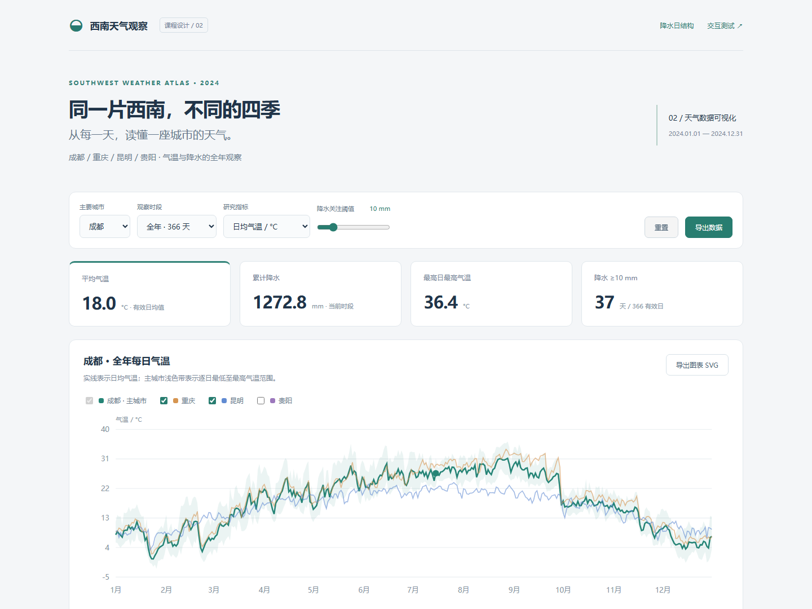
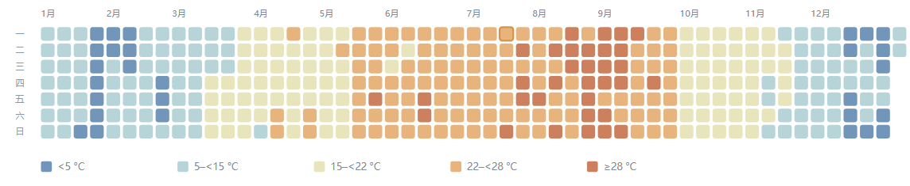

# 任务二_需求文档

公共数据源、字段和计算口径见《期中课程设计报告.md》第 2 章。


## 7  任务二：天气可视化需求文档


### 7.1 选题与背景

选择题目第二项中的“天气等相关数据”，研究四座西南城市在 2024 年的气温和降水差异。面向需要从全年趋势定位到月份、再查看某一天的课程阅读场景，强调概览与细节相互联动。


### 7.2 可视化介绍与亮点

采用多城市时间序列、全年日历热力图、四城排序条形比较和逐日明细表。曲线回答“何时变化”，日历回答“在全年哪里出现集中变化”，比较条形图回答“相同时段哪座城市更高”，日期表展示准确数值。主城市气温带显示每日最低至最高范围，不表示置信区间。

| 编号 | 功能需求 | 验收标准 |
| --- | --- | --- |
| W1 | 主城市、月份与指标筛选 | 四城可选；全年/1–12 月；温度与降水切换；图表、卡片、表格同步 |
| W2 | 城市对比曲线 | 主城市始终显示；其他城市开关只影响曲线，不删除四城统计 |
| W3 | 日历联动 | 一格一天，含闰日；点击日期切换月份并更新日期明细 |
| W4 | 可调降水阈值 | 1–50 mm；改变阈值线、关注日数及降水日历边框 |
| W5 | 精确读数与键盘 | 主城市曲线点、日历色块支持点击/Enter/空格；明细显示四城同日值 |
| W6 | 导出与重置 | CSV 只含当前主城市、当前时段的全部字段；SVG 导出当前趋势图 |
| W7 | 日历固定色阶与缺测 | 城市切换不改变分级边界；缺测为灰色，不作为零处理 |


### 7.3 非功能要求

离线运行；页面与组件分离；SVG 保持缩放；手机图表在容器内滚动，控件自动换行；真实来源、时间标准、单位和缺测口径始终可查。输出描述性研究结果，不根据一年数据做长期趋势或因果推断。


## 8  任务二：架构与交互实现

| 模块 | 作用 |
| --- | --- |
| filterDays / summarize | 按月筛选；分别计算有效均温、累计降水、最高温与降水日数 |
| TrendChart | 多城市曲线、主城市温度带、降水细柱、阈值线与日期点交互 |
| WeatherCalendar | 366 个日历色块；固定色阶、阈值框与选中日期框 |
| app.js | 维护状态、统一渲染卡片/曲线/日历/对比/明细/数据表 |
| tests.html / tests.js | 21 条可重复运行的组件测试及实时交互实例 |


### 8.1 复用接口

```javascript
const options = {
  primary: 'chengdu', month: '7', metric: 'rain',
  threshold: 10, selectedDate: '2024-07-15',
  onSelect: date => updateDate(date)
};
new WeatherViz.TrendChart(trendNode).render(cities, options);
new WeatherViz.WeatherCalendar(calendarNode)
  .render(city, options);
const summary = WeatherViz.summarize(
  WeatherViz.filterDays(city.days, '7'));
```


### 8.2 联动规则

城市切换保留月份与合法的所选日期；手动月份切换时，若原日期不在该月则选择该月首日。日历点击把月份切换到点击日期所属月。曲线点只更新日期明细。主要城市与其他曲线城市使用独立状态，避免关闭开关后主城市消失。


### 8.3 图形计算与缺测

日期以 UTC 毫秒差计算布局，避免浏览器本地时区影响日历列位置；2024 年 1 月 1 日为周一。缺测点断开折线，温度带按连续有效片段绘制。统计不足时显示“—”；无有效曲线数据时显示空态。降水单位在逐日图为 mm，在时段对比中对有效日量求和。


## 8.4  任务二实际运行效果





主城市默认成都，时间默认全年，默认显示成都、重庆、昆明三条曲线。页面下半部提供四城同周期排序、所选日期明细和完整的可滚动逐日数据表。


## 9  任务二：研究结果与解释

| 城市 | 最暖月 / 月均温 | 最冷月 / 月均温 | 降水量最高月 |
| --- | --- | --- | --- |
| 成都 | 8 月 / 28.57 °C | 12 月 / 5.97 °C | 7 月 / 378.95 mm |
| 重庆 | 8 月 / 30.47 °C | 12 月 / 7.57 °C | 6 月 / 230.08 mm |
| 昆明 | 7 月 / 21.71 °C | 1 月 / 8.31 °C | 6 月 / 220.32 mm |
| 贵阳 | 7 月 / 23.32 °C | 12 月 / 4.93 °C | 6 月 / 395.58 mm |


### 9.1 温度差异

在本年度网格样本中，重庆年均温 19.41 °C，高于成都 17.96 °C、昆明 16.15 °C 与贵阳 15.57 °C。重庆最高日最高气温为 40.54 °C；昆明对应值为 30.89 °C。切换到 8 月，可见重庆月均温为 30.47 °C，成都为 28.57 °C。

昆明最暖月与最冷月的月均温差约 13.41 °C，成都约 22.61 °C。本年度样本显示二者的月均温起伏幅度不同；不能仅据此推断多年气候趋势，也不将城市之间的差异解释为某一个原因。


### 9.2 降水分布

贵阳全年累计降水 1,443.85 mm，为四城最高；昆明 879.86 mm，为四城最低。贵阳 6 月累计 395.58 mm，约占全年 27.4%。成都降水量最高月为 7 月，其余三城在此样本中均为 6 月。


### 9.3 可复现的研究操作

把指标切到“日降水量”，月份切到 6 月，再选择贵阳为主城市，可结合阈值线与日历查看集中降水日期。随后切到成都 7 月，对照任务一的堆叠日结构和两页的累计量，交叉验证同一数据的统计一致性。


### 9.4 研究边界

不把网格数据称为气象站实测；LST 日界线与北京时间不同；研究年份仅为 2024；未做显著性检验或天气预测。关注阈值为探索工具，与预警发布阈值无对应关系。


## 10  任务二：交互测试与验收

测试入口：任务二_天气可视化/tests.html。真实浏览器执行 21 条组件断言，全部通过。

| 序号 | 测试内容 | 结果 |
| --- | --- | --- |
| 1 | 四城各有 366 条，合计 1464 条 | 通过 |
| 2 | 四城日期唯一且包含闰日 | 通过 |
| 3 | 全年筛选保留 366 天 | 通过 |
| 4 | 二月筛选为 29 天，七月为 31 天 | 通过 |
| 5 | 空时段不伪造均温与降水 0 | 通过 |
| 6 | 均温只除以有效温度天数 | 通过 |
| 7 | 真实数据最高温 ≥ 均温 ≥ 最低温 | 通过 |
| 8 | 降水分级色阶在 0.1 / 2 / 10 / 25 边界变化 | 通过 |
| 9 | 缺测颜色固定，不等同于无雨 | 通过 |
| 10 | 年度日历生成 366 个日期色块 | 通过 |
| 11 | 点击闰日发出正确日期 | 通过 |
| 12 | 日历支持 Enter 键 | 通过 |
| 13 | 日历支持空格键 | 通过 |
| 14 | 月份筛选降低其他月份透明度 | 通过 |
| 15 | 选中日期显示金色边框 | 通过 |
| 16 | 四城对比生成四条数据曲线 | 通过 |
| 17 | 气温带仅为主要城市绘制一次 | 通过 |
| 18 | 折线图日期点可点击选择 | 通过 |
| 19 | 降水图包含所选阈值线 | 通过 |
| 20 | 缺测折线不生成 NaN/Infinity | 通过 |
| 21 | 缺测断开折线，不跨越缺测日拼接 | 通过 |

额外页面流程：选择 2 月 29 日，月份应为 2 月、数据表应为 29 行；切换贵阳后保留闰日；设阈值为 23 mm，曲线与卡片同步；关闭对比曲线；键盘选日；读取实际下载文件；重置应恢复 366 行。


## 11  任务二：合作分工详细安排

以下为待真实成员确认的角色分工方案，与任务一沿用 A/B/C 角色。若独立完成，应将负责人据实改为本人，保留按阶段拆解的工作内容，不虚构其他成员的贡献。

| 工作包 / 建议日期 | 负责人 | 交付与协作内容 | 估时 / 验收 |
| --- | --- | --- | --- |
| 研究问题与需求<br>11/04–11/05 | A 主责、C 复核 | 确定四城同年比较、气温/降水指标、LST 口径；需求 W1–W7 | 2 h；指标无歧义 |
| 数据整理<br>11/05–11/06 | A（姓名待填） | 统一六字段；检查闰年、范围、缺测与单位；交付原始及整理数据 | 3 h；独立数据脚本通过 |
| 曲线与日历<br>11/07–11/10 | B（姓名待填） | 时间序列、气温带、阈值线、固定色阶、日期选择事件 | 6 h；21 条组件断言通过 |
| 多视图联动<br>11/10–11/11 | B 主责、A 支持 | 城市/月/指标/阈值统一状态；同日明细、对比条形与 CSV/SVG 导出 | 4 h；闰日流程与导出一致 |
| 研究结论与测试<br>11/11–11/14 | C（姓名待填） | 独立复核四城统计；浏览器流程、移动端与离线验证；整理截图 | 4 h；结论可从数据复算 |
| 报告与演示<br>11/14–11/16 | C 主责，全员复核 | 整合需求、代码接口、限制、分工与展示脚本；确认真实贡献 | 2 h；11/17 前完成装订和打包 |


### 交接与问题处理

数据负责人对字段、单位与时间标准负责；组件负责人对 render 接口和联动行为负责；测试负责人根据 W1–W7 提供“操作步骤—预期—实际—证据”。重大口径变化必须同时修正文档、数据解释、测试和结论，避免多个视图出现不同计算规则。

成员 A：________  真实贡献：________________________
成员 B：________  真实贡献：________________________
成员 C：________  真实贡献：________________________
